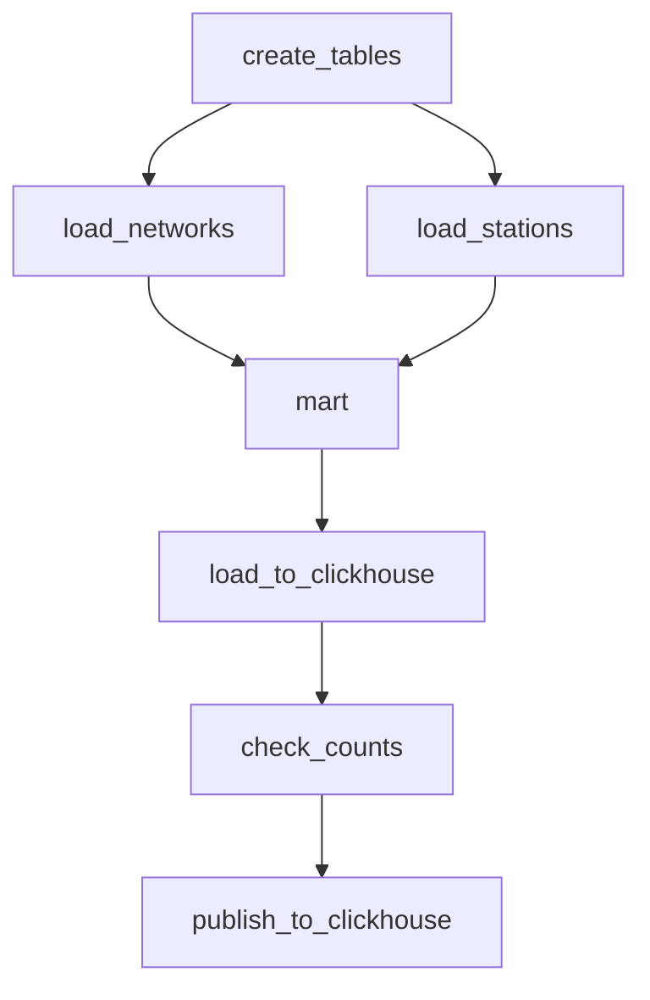

# ETL-пайплайн CityBikes

Финальный проект (3-й семестр). Полный data pipeline: загрузка данных в
Postgres, сборка One Big Table витрины на Spark с записью в HDFS, загрузка в ClickHouse
с атомарной публикацией и аналитический дашборд в Metabase - все оркестрируется одним
DAGом Airflow.

Автор: Spiridonov Aleksey

## Содержание

1. [Задания проекта](#задания-проекта)
2. [Данные](#данные)
3. [Архитектура решения](#архитектура-решения)
4. [Стек технологий](#стек-технологий)
5. [DAG Airflow](#dag-airflow)
6. [Логика трансформаций](#логика-трансформаций)
7. [Загрузка в ClickHouse](#загрузка-в-clickhouse)
8. [Дашборд Metabase](#дашборд-metabase)
9. [Сверка качества данных](#сверка-качества-данных)
10. [Структура репозитория](#структура-репозитория)
11. [Порядок запуска](#порядок-запуска)
12. [Тесты и линтер](#тесты-и-линтер)

## Задания проекта

| № | Задание | Где реализовано                                                                                                                              |
|---|---------|----------------------------------------------------------------------------------------------------------------------------------------------|
| 1 | Airflow: загрузка данных в Postgres | [`dags/citybikes_dag.py`](dags/citybikes_dag.py), [`extract.py`](src/thirdsemestrwork/extract.py), [`load.py`](src/thirdsemestrwork/load.py) |
| 2 | Spark: витрина One Big Table в HDFS | [`datamart.py`](src/thirdsemestrwork/datamart.py)                                                                                            |
| 3 | Загрузка витрины в ClickHouse | [`ch_load.py`](src/thirdsemestrwork/ch_load.py)                                                                                              |
| 4 | Дашборд в Metabase | раздел [<Дашборд Metabase>](#дашборд-metabase)                                                                                               |

## Данные

Источник - снапшоты открытого [CityBikes API](https://api.citybik.es/v2/) (данные о сетях
велошеринга по всему миру), файлы находятся в `data/` (в git не входят):

- `data/networks.json` - справочник сетей: **815 сетей**;
- `data/stations_output/stations_<network_id>.json` - **433 файла** со станциями,
  всего **56 739 записей** о станциях.

Особенности сырых данных, которые пришлось учитывать:

- у станций нет поля `id` - идентификатор строится из содержимого записи (см. ниже);
- встречаются дубликаты станций (4 шт. по составному ключу);
- значения `extra.renting/returning` приходят и как `bool`, и как строки `'1'/'true'/'0'/'false'`;
- `timestamp` в разных форматах: ISO 8601, `dd/MM/yyyy HH:mm:ss`, эпоха в секундах и миллисекундах;
- 8 сетей станций есть в станциях, но нет в справочнике сетей; у 395 сетей,
  наоборот, нет ни одной станции.

### Сверка с живым API
Локальные файлы сверены с `https://api.citybik.es/v2/` (на 10.11.2026):
- список сетей полностью совпадает: 815 сетей, 53 страны, расхождений по `id` нет;
- данные станций в локальных файлах зафиксированы **12.05.2025** (по полю `timestamp`); в живом
  API данные обновляются - сети выросли (velib: 1462 -> 1519 станций,
  hellocycling-tokyo: 3163 -> 4094), счетчики велосипедов - реальное время;
- снапшот - преобразованный ответ API: `free_bikes`/`empty_slots` переименованы в
  `bikes`/`free`, поле `id` станции вырезано. Поэтому `extract.py` нормализует имена
  полей, а `_station_id` берет родной `id`, когда он есть - пайплайн совместим и со
  снапшотом, и с живым API без правок кода;
- 8 сетей, отсутствующих в справочнике сетей, отсутствуют и в живом API - они исчезли
  из агрегатора после того как был сделан снапшот; их 592 станции в витрину не попадают
  (см. <Сверка качества данных>).

## Архитектура решения

```mermaid
flowchart LR
    A["JSON снапшот<br/>data/networks.json<br/>+ 433 × stations_*.json"] --> B["Airflow DAG<br/>citybikes_load"]
    B -->|"extract.py → load.py<br/>(upsert)"| C[("Postgres 18<br/>a_spiridonov_networks<br/>a_spiridonov_stations")]
    C -->|"чтение JDBC<br/>"| D["Spark 4.2<br/>datamart.py<br/>One Big Table"]
    D -->|"Parquet<br/>(write overwrite)"| E[("HDFS<br/>/user/a_spiridonov/dm")]
    E -->|"движок HDFS<br/>"| F[("ClickHouse<br/>a_spiridonov_dm_new")]
    F -->|"EXCHANGE TABLES<br/>(атомарно)"| G[("ClickHouse<br/>a_spiridonov_dm")]
    G --> H["Metabase<br/>дашборд + фильтр по стране"]
```



Сервисы docker compose и порты на хосте:

| Сервис | Образ | Порт | Назначение |
|--------|-------|------|------------|
| airflow-api-server / scheduler / dag-processor | citybikes-airflow:3.3.1 (сборка из `Dockerfile`) | **8080** | оркестрация (LocalExecutor) |
| postgres | postgres:18.6-alpine3.24 | **5433** | хранилище + метабаза Airflow |
| namenode / datanode | bde2020/hadoop 2.0.0-hadoop3.2.1 | **9870** (UI) | HDFS для витрины |
| clickhouse | clickhouse-server:26.8.6 | **8123** (HTTP), **9000** (native) | витрина для BI |
| metabase | metabase:v0.63.18 | **3000** | визуализация |

Учетные данные тестового стенда локальные и заданы в `docker-compose.yml` (переопределяются через
переменные окружения, `src/thirdsemestrwork/config.py`): Postgres - `etl/etl`;
ClickHouse - `etl/etl` для пайплайна и `metabase/metabase_ro` (только чтение) для BI.
Порты опубликованы только на `127.0.0.1` - стенд недоступен из внешней сети.

## Стек технологий

| Слой | Технология |
|------|------------|
| Оркестрация | Apache Airflow 3.3.1 (LocalExecutor, SimpleAuthManager, PythonOperator) |
| Хранилище | PostgreSQL 18.6 (SQLAlchemy 2, psycopg2, JSONB) |
| Обработка | Apache Spark 4.2.0 (PySpark, ANSI mode, local[2]) |
| Файловый слой | Hadoop HDFS 3.2.1 (Parquet) |
| Витрина | ClickHouse 26.8.6 (clickhouse-connect, HDFS engine, MergeTree) |
| Визуализация | Metabase v0.63.18 |
| Инструменты | uv, pytest, ruff |

## DAG Airflow

`dags/citybikes_dag.py`, `dag_id = citybikes_load`, ежедневное расписание `0 3 * * *` - 
в 03:00 по Europe/Moscow, `catchup=False` - без догоняющих прогонов за пропущенное время,
`max_active_runs=1` (полная перезагрузка снапшота не должна идти параллельно сама с собой),
`retries=2` с задержкой 1 минута.



| Задача | Что делает                                                                                              |
|--------|---------------------------------------------------------------------------------------------------------|
| `create_tables` | создает таблицы `a_spiridonov_networks` / `a_spiridonov_stations`, если их нет                          |
| `load_networks` | `networks.json` -> Postgres, батчи по 500, upsert по `id`                                               |
| `load_stations` | 433 файла станций -> Postgres, батчи по 1000, upsert по `(network_id, station_id)`                      |
| `mart` | Spark: читает Postgres по JDBC, собирает витрину, пишет Parquet в HDFS                                  |
| `load_to_clickhouse` | таблица `_hdfs` (HDFS engine) -> заливка во временную таблицу `_new`; основная таблица не трогается     |
| `check_counts` | сверка Postgres <-> витрина **до публикации** (см. ниже); при расхождении - `RuntimeError`, DAG красный |
| `publish_to_clickhouse` | атомарная замена основной таблицы через `EXCHANGE TABLES`                                               |

Ключевые решения загрузки (`extract.py`, `load.py`):

- `network_id` станций берется из имени файла `stations_<id>.json`; файлы с битым JSON (недозагруженные)
  пропускаются с предупреждением в лог;
- поля API `free_bikes`/`empty_slots` нормализуются в `bikes`/`free` (только если поле
  отсутствует - значение `0` не затирается);
- `station_id`: родное поле `id` записи, если есть; иначе составной`md5(network_id|name|lat|lon)`;
- JSONB-колонки объявлены как `JSONB(none_as_null=True)` - SQL `NULL` отличим от jsonb `null`;
- дубли ключей внутри батча схлопываются до вставки (иначе `ON CONFLICT DO UPDATE`
  падает с `CardinalityViolation`);
- идемпотентность: повторный запуск DAG обновляет данные upsert'ами, а витрина и
  ClickHouse перезаливаются целиком.

## Логика трансформаций

`src/thirdsemestrwork/datamart.py` - сборка One Big Table (27 колонок):

- **Чтение Postgres из Spark по JDBC**: данные для входа извлекаются из `DATABASE_URL`
  через `make_url` (корректно раскодируются percent-encoded пароли), JDBC-драйвер
  `postgresql-42.7.4.jar` включен в docker образ на этапе сборки; JSONB-колонки читаются подзапросами с `::text`;
- **Парсинг вложенных JSON**: `location`, `company`, `extra` разбираются `from_json`
  по заранее описанным схемам (`StructType`);
- **Соединение**: сети `LEFT JOIN` станции по `network_id`. Сети без станций (395 шт.)
  остаются в витрине строками-маркерами (`station_id IS NULL`) - витрина покрывает все
  815 сетей; станции сетей, которых нет в справочнике, в витрину не попадают;
- **Приведение типов в ANSI-режиме Spark 4**:
  - `_parse_datetime`: ISO-строка -> `dd/MM/yyyy HH:mm:ss` -> эпоха (сек/мс, порог 1e11) → иначе `NULL`;
  - `_to_bool`: `'1'/'true' → True`, `'0'/'false' → False`, иначе `NULL`;
- **Чистка строк**: `trim` названий/городов/стран, `transform(payment, trim)` по массиву;
- **Вычисляемые поля**: `free_bikes`/`empty_slots` (переименованные bikes/free),
  `companies_count = size(company)`, `network_station = сеть/станция`;
- Параметры сессии: `local[2]`(локальный режим: Spark работает в JVM задачи, без кластера,
  2 рабочих потока), driver 2g (память процесса), `shuffle.partitions=4`, `session.timeZone=UTC`,
  запись `mode('overwrite')` (для идемпотентности) в `hdfs://namenode:8020/user/a_spiridonov/dm`.

## Загрузка в ClickHouse

`src/thirdsemestrwork/ch_load.py` - паттерн "временная + атомарная публикация":

1. `a_spiridonov_dm_hdfs` - таблица с движком **HDFS** поверх Parquet-файлов витрины ;
2. `a_spiridonov_dm_new` - временная таблица MergeTree, в нее
   заливается `SELECT * FROM _hdfs`;
3. задача `check_counts` сверяет числа (см. ниже);
4. `publish_to_clickhouse`: `CREATE TABLE IF NOT EXISTS` основной таблицы и
   **`EXCHANGE TABLES`** - атомарная замена местами; пользователь не видит
   неполную витрину, а при падении на этапе проверки основная таблица
   остается нетронутой.

Типы витрины: `LowCardinality(String)` для `network_id`, `LowCardinality(Nullable(String))`
для город/страна/система, `Array(String)` для `company/payment`, `Nullable(DateTime64(6,'UTC'))`
для времени, `Nullable(Bool/Int32)` для флагов и счетчиков.

## Дашборд Metabase

13 карточек + фильтр по стране (источник - `citybikes.a_spiridonov_dm`, нативный
ClickHouse-драйвер):

| Карточка                                               | Визуализация       |
|--------------------------------------------------------|--------------------|
| Всего сетей велошеринга                                | число              |
| Всего станций                                          | число              |
| Сети без данных о станциях, %                          | число              |
| Станции без названия, %                                | число              |
| Станции без данных о велосипедах, %                    | число              |
| Свободные велосипеды / свободные доки по миру          | горизонтальный бар |
| Электровелосипеды по странам                           | бар                |
| Оплата картой/телефоном по городам                     | бар                |
| Топ-10 сетей по числу станций                          | горизонтальный бар |
| Топ-10 стран по числу станций                          | горизонтальный бар |
| Самые загруженные станции (доля свободных велосипедов) | таблица            |
| Карта станций мира                                     | карта              |
| Международные компании                                 | таблица            |


### Запросы карточек

Каждая карточка - SQL-вопрос к `citybikes.a_spiridonov_dm`. В каждом запросе переменная
`{{country}}` - Field Filter на колонку `country` (Required - выкл).

**Всего сетей** / **Всего станций** / **Сети без данных о станциях, %** (скаляры):
```sql
SELECT uniqExact(network_id) AS networks FROM citybikes.a_spiridonov_dm WHERE {{country}}
```
```sql
SELECT count(station_id) AS stations FROM citybikes.a_spiridonov_dm WHERE {{country}}
```
```sql
SELECT round(uniqExactIf(network_id, isNull(station_id)) * 100.0 / uniqExact(network_id), 1) AS pct
FROM citybikes.a_spiridonov_dm WHERE {{country}}
```

**Станции без названия, %** / **без данных о велосипедах, %** (скаляры):
```sql
SELECT round(countIf(isNull(station_name) or station_name = '') * 100.0 / count(), 2) AS pct
FROM citybikes.a_spiridonov_dm WHERE station_id IS NOT NULL AND {{country}}
```
```sql
SELECT round(countIf(isNull(free_bikes)) * 100.0 / count(), 2) AS pct
FROM citybikes.a_spiridonov_dm WHERE station_id IS NOT NULL AND {{country}}
```

**Свободные велосипеды / свободные доки** (горизонтальный бар):
```sql
SELECT 'Свободные велосипеды' AS metric, sum(free_bikes) AS value
FROM citybikes.a_spiridonov_dm WHERE {{country}}
UNION ALL
SELECT 'Свободные доки', sum(empty_slots)
FROM citybikes.a_spiridonov_dm WHERE {{country}}
```

**Электровелосипеды по странам** (бар):
```sql
SELECT country, countIf(has_ebikes) AS stations_with_ebikes, sum(ebikes) AS ebikes
FROM citybikes.a_spiridonov_dm WHERE {{country}}
GROUP BY country ORDER BY stations_with_ebikes DESC LIMIT 10
```

**Оплата картой/телефоном по городам** (бар):
```sql
SELECT city, countIf(has(payment, 'creditcard')) AS with_card,
       countIf(has(payment, 'phone')) AS with_phone
FROM citybikes.a_spiridonov_dm WHERE {{country}}
GROUP BY city ORDER BY with_card DESC LIMIT 10
```

**Топ-10 сетей по числу станций** (горизонтальный бар):
```sql
SELECT network_id, concat(coalesce(network_name, ''), ' — ', coalesce(city, '')) AS network,
       count(station_id) AS stations
FROM citybikes.a_spiridonov_dm WHERE {{country}}
GROUP BY network_id, network ORDER BY stations DESC LIMIT 10
```

**Топ-10 стран по числу станций** (горизонтальный бар):
```sql
SELECT country, count(station_id) AS stations
FROM citybikes.a_spiridonov_dm WHERE {{country}}
GROUP BY country ORDER BY stations DESC LIMIT 10
```

**Самые востребованные станции** (таблица; `total_slots` — всего мест, `free_pct` — доля свободных велосипедов, сортировка по возрастанию = самые разобранные):
```sql
SELECT network_station, city, free_bikes,
       free_bikes + empty_slots AS total_slots,
       round(free_bikes * 100.0 / (free_bikes + empty_slots), 1) AS free_pct
FROM citybikes.a_spiridonov_dm
WHERE free_bikes >= 1 AND free_bikes + empty_slots >= 20 AND {{country}}
ORDER BY free_pct ASC, total_slots DESC LIMIT 10
```

**Международные компании** (таблица):
```sql
SELECT company, uniqExact(network_id) AS networks, uniqExact(country) AS countries
FROM (
    SELECT arrayJoin(company) AS company, network_id, country
    FROM citybikes.a_spiridonov_dm
    WHERE {{country}}
)
GROUP BY company
ORDER BY countries DESC, networks DESC
LIMIT 10
```

**Карта станций мира** (карта):
```sql
SELECT round(station_latitude, 1) AS latitude, round(station_longitude, 1) AS longitude,
       count(station_id) AS stations, sum(free_bikes) AS bikes
FROM citybikes.a_spiridonov_dm
WHERE {{country}} AND station_latitude IS NOT NULL
GROUP BY latitude, longitude
```

Фильтр: "Страна" - dashboard-фильтр типа **Location**, подключен ко всем карточкам через
переменную `{{country}}` (Field Filter -> колонка `country`, semantic type `Country`).

## Сверка качества данных

Задача `check_counts` сравнивает Postgres с витриной **до публикации** и падает при
расхождении: число сетей, число станций, заполненность `free_bikes`, `renting`,
`timestamp`, а также `строк в HDFS == строк во временной таблице ClickHouse`.
Сверка сознательно асимметрична: Postgres считает "ключ присутствует в JSON"
(`extra->>'renting' IS NOT NULL`), витрина - "значение успешно распарсилось"
(`isNotNull(renting)`). Значение, которое не удалось привести (например, `renting='yes'`),
в витрине исчезнет - проверка заметит потерю и остановит публикацию. 

Константная цепочка чисел на текущих данных:

| Этап | Число | Комментарий                                         |
|------|-------|-----------------------------------------------------|
| Записей о станциях в файлах | 56 739 | 433 файла                                           |
| Строк в Postgres | 56 735 | -4 дубля по ключу `(network_id, station_id)`        |
| Строк-станций в витрине | 56 143 | −592 станции 8 сетей без записи в справочнике сетей |
| Строк-маркеров сетей без станций | 395 | LEFT JOIN                                           |
| **Итого строк витрины** | **56 538** | 56 143 + 395                                        |
| Сетей | 815 | во всех слоях совпадает                             |

## Структура репозитория

```
├── dags/
│   └── citybikes_dag.py            # DAG пайплайна (7 задач)
├── src/thirdsemestrwork/
│   ├── config.py                   # пути, таблицы, подключения из ENV
│   ├── extract.py                  # чтение JSON-снапшотов
│   ├── load.py                     # схема Postgres, дедупликация, upsert
│   ├── datamart.py                 # Spark: сборка витрины, запись Parquet в HDFS
│   └── ch_load.py                  # ClickHouse: временная + EXCHANGE TABLES
├── tests/
│   ├── test_extract.py             # парсинг, ключи станций, битый JSON
│   ├── test_datamart.py            # _to_bool, _parse_datetime, jdbc-креды
│   └── test_smoke.py               # импорт пакета
├── scripts/                        # скрипт исследования данных
├── clickhouse/
│   └── metabase-user.xml           # read-only пользователь Metabase
├── postgres/init/                  # SQL при первом старте Postgres (CREATE DATABASE airflow)
├── data/                           # файлы CityBikes (в git не входит)
├── docker-compose.yml              # весь стек
├── Dockerfile                      # Airflow + JDK17 + PySpark + JDBC
├── hadoop.env                      # конфиг Hadoop (HDFS)
└── .env.example                    # шаблон секретов
```

## Порядок запуска

Требования: Docker Desktop (WSL2), ~8 ГБ свободной памяти;

1. Скачать данные и положить в `data/` (`networks.json`, `stations_output/*.json`).
2. Создать `.env` из шаблона и сгенерировать секрет:
   ```bash
   cp .env.example .env
   uv run python -c 'import secrets; print(secrets.token_hex(64))'
   # вставить значение в AIRFLOW__API_AUTH__JWT_SECRET в .env
   ```
3. Собрать и поднять стек:
   ```bash
   docker compose up -d --build     
   docker compose ps  # postgres/clickhouse/airflow должно быть healthy;               
   ```
4. Узнать пароль `admin` (Airflow генерирует его случайно и печатает в лог):
   ```bash
   docker compose logs airflow-api-server | Select-String -i password
   ```
   UI: http://localhost:8080
5. Запустить DAG: DAGs -> `citybikes_load` -> включить переключатель DAG (unpause) и нажать
   Start для первого прогона; дальше DAG запускается сам ежедневно в 03:00. 
   Дождаться 7 зеленых задач.
6. Проверить результат:
   ```bash
   docker exec citybikes-clickhouse clickhouse-client --user etl --password etl \
       -q "SELECT count() FROM citybikes.a_spiridonov_dm"     # должно быть 56538
   ```
   HDFS-браузер: http://localhost:9870 -> Utilities -> Browse the file system ->
   `/user/a_spiridonov/dm`.
7. Metabase: http://localhost:3000 → первичная настройка (создать админа) ->
   Admin → Databases → добавить ClickHouse: host `clickhouse`, port `8123`,
   user `metabase`, password `metabase_ro`, db `citybikes`. В Table Metadata выставить колонке
   `country` semantic type `Country` (нужно для Location фильтра дашборда).
8. Остановка: `docker compose down`. **Флаг `-v` ** сотрет тома, включая дашборд Metabase.

## Тесты и линтер

Проверяют все, что хотя бы раз ломалось при создании pipeline. 

```bash
uv sync --group pipeline
uv run pytest -q # 29 тестов
uv run ruff check . 
```

Покрытие: стабильность и уникальность ключа станции, приоритет родного `id`, нормализация
полей API, пропуск битого JSON, 9 кейсов `_to_bool`, 8 кейсов `_parse_datetime`
(ISO / dd/MM/yyyy / эпоха сек и мс), декодирование percent-encoded кредов для JDBC.
Spark-тесты пропускаются автоматически, если pyspark/Java локально недоступны.